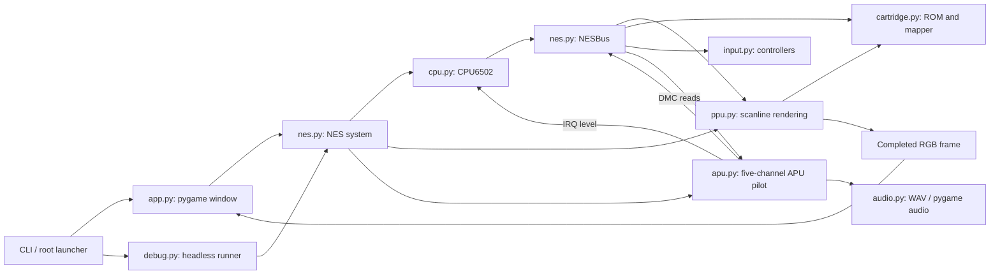

# pynes

`pynes` is an experimental Nintendo Entertainment System (NES) emulator written
in Python and developed with the assistance of artificial intelligence (AI).
It is a test project for exploring emulator implementation, debugging, and
optimization through an AI-assisted development workflow.

The project includes an installable Python package, a desktop window, a
headless command-line runner, generated-ROM tests, and continuous integration.
It is currently pre-alpha: implemented behavior is checked through tests and
local ROM experiments, and full NES compatibility is still a work in progress.

## Purpose And AI-Assisted Development

This repository serves as a practical experiment in building a NES emulator
with AI assistance. Changes are evaluated through source review, automated
tests, hardware references, and measured runtime behavior. Passing the current
test suite establishes coverage of those scenarios; compatibility with an
individual game requires testing that game separately.

The README describes the current checkout. Previously published releases may
contain fewer features; consult their corresponding [release notes](docs/releases/).

## Implemented Features

- iNES and basic NES 2.0 ROM loading for NROM (0), MMC1 (1), and UxROM (2).
  See [cartridge formats](docs/cartridge-formats.md) for supported layouts.
- A 6502 CPU core implementing the official opcodes, RAM mirroring, and a CPU
  memory bus with mapped PPU and controller registers.
- Scanline-based backgrounds with pattern tables, attributes, palettes,
  scrolling, and cartridge-controlled nametable mirroring.
- 8x8 and 8x16 sprites with flipping, palette selection, OAM/background
  priority, clipping, and the eight-sprite scanline limit.
- OAM/DMC DMA transfers and stalls, NMI/APU IRQ delivery, and approximate
  sprite-zero-hit timing.
- A pygame desktop runner with keyboard controls, pause, reset, and automatic
  PPU frame pacing targeting 60 Hz.
- Headless smoke tests, CPU traces, partial disassembly, and local performance
  benchmarks.
- An opt-in NTSC APU pilot with two pulse channels, triangle, noise, DMC sample
  playback, WAV export, and experimental pygame audio.

See [Current Limitations](#current-limitations) before assessing game compatibility.

## Requirements

- Python 3.11 or newer
- pygame for the desktop window; the headless core has no runtime dependencies.

Optional dependency groups in [pyproject.toml](pyproject.toml):

| Extra | Purpose |
|---|---|
| `display` | pygame desktop window; pilot audio also requires SDL_mixer support |
| `dev` | pytest, Ruff, pygame, and package build tooling |
| `standalone` | pygame and PyInstaller for bundled executables |

## Release Status

- Project version: `1.1.0` (release preparation; experimental emulator)
- Release scope and migration: [v1.1.0 notes](docs/releases/v1.1.0.md).
- Supported Python: Python 3.11+
- CI matrix: Python 3.11 on Windows, Linux, and macOS.
- Standalone release targets: Windows and Linux x86-64.

This checkout prepares the next release after
[v1.0.3, published on July 2, 2026](https://github.com/sgalvez/pynes/releases/tag/v1.0.3).
It delivers the five-channel APU pilot, scanline rendering, performance
optimizations, F3 diagnostics, and expanded documentation. Audio is enabled
explicitly with `--audio-pilot`. Publishing requires the release tag after
the preparation PR is merged and validated.

## Development Setup

Create a virtual environment, install the project in editable mode, and include
the development dependencies:

```bash
python -m venv .venv
source .venv/bin/activate
python -m pip install --upgrade pip
python -m pip install -e ".[dev,display]"
```

On Windows PowerShell, activate the environment with:

```powershell
.\.venv\Scripts\Activate.ps1
```

For release validation and package builds, the `dev` extra includes pytest,
Ruff, pygame, and Python build tooling:

```bash
python -m pip install -e ".[dev]"
```

## Running The CLI

From a checkout, the root launcher runs the local source directly:

```bash
python nes.py --help
python nes.py rom/game.nes
```

After installation, run:

```bash
nes-py --help
nes-py --version
nes-py path/to/game.nes
nes-py path/to/game.nes --trace --disassemble
nes-py path/to/game.nes --smoke-test 1000
```

You can also run the package module directly:

```bash
python -m nes_py --help
python -m nes_py --version
python -m nes_py path/to/game.nes
```

The desktop runner uses pygame. Install the `display` extra when you want the
game window:

```bash
python -m pip install -e ".[display]"
```

The window advances one PPU frame per refresh and targets 60 Hz. Backgrounds
and sprites are composed by scanline, and pygame reuses the RGB buffer and
surfaces. `--instructions-per-frame` remains available as a debugging override;
normal gameplay uses automatic frame pacing.

The window can be resized or maximized. Nearest-neighbor scaling preserves the
native 256:240 image proportions, with black borders when the window has a
different shape. Restoring the window or starting at `--scale 1` uses the same
resize behavior.

## Workspace

Open `pynes.code-workspace` in VS Code or a compatible editor. Its first folder,
**Emulador**, exposes the core `nes.py`, `cpu.py`, `ppu.py`, and `app.py` directly.
The **Pruebas** and **Proyecto** folders provide tests and repository tooling.

```text
nes.py                 Run the emulator from the repository root
pynes.code-workspace   Editor workspace with the emulator folder first
src/nes_py/nes.py      NES system, memory bus, DMA, and frame execution
src/nes_py/ppu.py      Background, scrolling, sprites, and RGB output
src/nes_py/app.py      Window, display pacing, and keyboard controls
tests/                 Generated-ROM regression tests
scripts/               Profiling and release tooling
rom/                   Local ROMs; .nes files are ignored by Git
```

The root `nes.py` is a launcher. The emulator implementation remains in
[`src/nes_py/nes.py`](src/nes_py/nes.py), which is directly visible in the
**Emulador** workspace folder.

## Architecture

For a detailed introduction with examples and diagrams, read
[How a NES emulator works](docs/how-emulators-work.md). It explains the CPU,
bus, cartridge, graphics, audio, controllers, and shared timing, then follows
a button press through the current pynes implementation.



The NES wrapper advances the PPU at three cycles per CPU cycle, including DMA
stalls and NMI service time. The PPU composes visible scanlines and prepares a
completed RGB image at vblank. pygame shares that buffer and reuses its display
surfaces. CPU instructions and scanlines are processed in batches, so timing
remains approximate.

The optional APU advances with the same CPU time and generates PCM samples.
WAV export works without an audio device; live playback uses pygame's mixer.

## Controls

- Arrow keys: D-pad
- Z: A
- X: B
- Right Shift: Select
- Enter: Start
- Space: Pause or resume
- R: Reset
- F3: Toggle FPS and frame timings in the window title
- Escape or window close: Quit

## Debugging And Validation

Use `--trace` to print CPU trace lines while running. Each trace includes the
program counter, opcode, registers, status flags, stack pointer, and cycle
count. Add `--disassemble` for a best-effort instruction mnemonic:

```bash
python -m nes_py path/to/game.nes --trace --disassemble
```

For headless validation, use `--smoke-test` with a fixed instruction count. This
loads the ROM, steps CPU instructions, prints a summary, and exits without
opening a window:

```bash
python -m nes_py path/to/game.nes --smoke-test 1000 --trace --disassemble
```

Write longer traces to a file with `--trace-file`:

```bash
python -m nes_py path/to/game.nes --smoke-test 10000 --trace --trace-file trace.log
```

## Experimental APU Pilot

The audio pilot implements NTSC **pulse 1, pulse 2, triangle, noise, and DMC**.
It includes pulse duty patterns and sweep, envelopes, length counters, the
triangle linear counter, both noise modes, buffered DPCM sample playback, and
nonlinear mixing into bounded PCM output. Frame/DMC IRQs reach the CPU, and
DMC reads use the current cartridge mapping with nominal DMA stalls. Audio is
opt-in; interrupt and DMA timing still use instruction boundaries.

Generate a demo with melody, harmony, bass, noise percussion, and an original
DPCM drum sample without a ROM or audio device:

```bash
python scripts/apu_pilot.py
```

Open `build/apu-pilot.wav` in an audio player. To hear one demo channel alone:

```bash
python scripts/apu_pilot.py --demo-channel triangle --output build/triangle.wav
```

`--demo-channel` accepts `all`, `pulse1`, `pulse2`, `triangle`, `noise`, and `dmc`.
To hear the DMC sample alone:

```bash
python scripts/apu_pilot.py --demo-channel dmc --output build/dmc.wav
```

To try all five channels with a local game in the desktop window:

```bash
python nes.py rom/game.nes --audio-pilot
```

Live audio requires pygame built with **SDL_mixer** and an available audio
device. If that support is missing, the command reports the problem; WAV export
still works, including under WSL. To capture a longer local game sample:

```bash
python scripts/apu_pilot.py --rom rom/game.nes --frames 600 --output build/game-audio.wav
```

Read the [pilot guide](docs/apu/pilot.md) for scope and device requirements,
and [DMC and IRQ integration](docs/apu/dmc.md) for memory, interrupts, and timing.
The saved
[APU explanation in Spanish](docs/apu/overview.es.md) introduces the hardware
and the complete five-channel signal path.

## ROM Handling

Supply ROMs locally, such as your own dumps or homebrew/test ROMs with suitable
licenses. The repository does not distribute commercial games. `.nes` files
are ignored by Git, including files under the optional local `rom/` directory.

Proprietary ROMs used during development remain on the developer's machine.
Automated tests build small ROMs and graphics in memory so they can run without
those private files. Keep private ROMs, extracted game data, and game screenshots
out of commits and release artifacts.

## Current Limitations

- Mapper support is incomplete.
- PPU behavior is incomplete and not cycle-accurate.
- Rendering uses scanline snapshots; changes within a scanline, color emphasis,
  odd-frame dot skipping, and the hardware sprite-overflow bug are not emulated.
- Audio implements five experimental NTSC channels. Exact DMA arbitration,
  interrupt collision timing, expansion audio, band-limited resampling, the
  full analog filter response, and audio-device clock feedback are pending.
- Input supports one keyboard-backed controller.
- NES 2.0 support covers standard NTSC/multiple-region boards on the supported
  mappers. Unsupported submappers, memory layouts, console types, and peripherals
  are rejected with specific errors; see [cartridge formats](docs/cartridge-formats.md).
- Unofficial CPU opcodes, save states, battery-backed save persistence, and
  complete interrupt/APU behavior are not implemented.

## Running Tests

```bash
python -m pytest
python -m ruff check .
```

Tests cover CPU behavior, cartridge loading and bank switching, the memory bus,
controller input, PPU registers, scrolling, sprite composition, DMA/NMI timing,
CLI behavior, and build helpers. A dummy SDL display exercises frame presentation,
RGB color preservation, and resizing/maximize/restore transitions without
requiring a physical window. All test ROMs and patterns are generated.

The APU pilot adds numerical PCM checks, WAV-format validation, generated-demo
exports, and playback queue/control tests. See the [pilot guide](docs/apu/pilot.md)
for the audio checks and their device-testing limits.

For a focused graphics check:

```bash
python -m pytest tests/test_ppu.py tests/test_rendering.py tests/test_nes.py tests/test_app.py
```

## Performance Checks

Run the lightweight profiler with:

```bash
python scripts/profile_performance.py
```

It measures startup, package imports, CI/CD script generation, and available
emulator operations. See the [performance report](docs/performance/performance-report.md) for baselines,
measurement conditions, and optimization notes.

Measure frame throughput with a locally supplied ROM, including sprite
composition and RGB output, without opening a window:

```bash
python scripts/profile_performance.py --rom rom/game.nes --frames 120 --warmup-frames 300
```

This reports headless throughput rather than window FPS. The ROM is only read
from your machine; automated tests use generated ROMs and patterns.

Include the APU pilot in the same benchmark to measure its CPU cost:

```bash
python scripts/profile_performance.py --rom rom/game.nes --audio-pilot --frames 120 --warmup-frames 300
```

Audio synthesis batches elapsed CPU time at register/status accesses and PCM
reads. This avoids per-instruction synthesis while preserving generated samples;
the [performance report](docs/performance/performance-report.md) records the
before/after measurements.

For the DMC increment, `--dmc-stress` adds an artificial fastest-rate looping
reader, including when the local game would normally disable that channel:

```bash
python scripts/profile_performance.py --rom rom/game.nes --audio-pilot --dmc-stress --warmup-frames 360 --frames 120
```

Choose a warmup that reaches actual music/gameplay in the ROM. A silent intro
still measures synthesis overhead but does not cover the cost of active voices.

Press **F3** during desktop playback to show a half-second average in the title:
FPS, emulation time, audio time, video time, and `slow` frames. Emulation covers
CPU/PPU work and scheduled APU events; audio includes deferred synthesis and
queuing; video includes scaling and presentation. `slow X/N` counts frames
whose combined work exceeds the 16.7 ms budget, excluding the pacing wait.
Press F3 again to hide the timings.

For a level-specific slowdown, note these timings and whether it happens in a
normal or maximized window. Low FPS confirms missed frame deadlines. Graphics
misalignment at steady FPS still needs a rendering/timing investigation.

The scanline/frame-pacing pass measured about 37.5 to 72.2 headless frames/sec
on the same local frame workload. See the report for the comparison procedure;
results depend on hardware, interpreter, ROM, and scene. CPU tracing writes a
line per instruction and can substantially reduce throughput.

## Troubleshooting

| Symptom | Check |
|---|---|
| `pygame is required` | Install `python -m pip install -e ".[display]"` in the active environment. |
| `No module named nes_py` | Install the package in editable mode or use `python nes.py` from the repository root. |
| A NES 2.0 ROM will not load | Check the reported mapper, submapper, and hardware requirement against [cartridge format support](docs/cartridge-formats.md). The file format alone does not determine game compatibility. |
| Black or incorrect graphics | Confirm the ROM's mapper is supported and compare against the known PPU limitations; record a trace or headless result. |
| Slow or uneven playback | Disable tracing, use automatic frame pacing, and benchmark the local ROM; a smaller `--scale` can reduce display work. |
| Unsupported mapper, format, or opcode | Record the exact error and ROM metadata when reporting the issue; that behavior requires additional emulator support. |
| No sound | Audio requires `--audio-pilot`, pygame with SDL_mixer, and an audio device. Use WAV export to test synthesis independently. |
| Incomplete music or effects | All five base APU channels are implemented experimentally. Check mapper support and remaining DMA, timing, filtering, and expansion-audio limitations. |

## Contributing

Keep changes focused and describe the observed problem, expected behavior, and
how the result was verified. Include generated-ROM regression tests for emulator
behavior changes, and record comparable measurements for performance changes.
For a bug report, include the Python/platform versions, command line, mapper,
reproduction steps, and relevant output. Private ROMs can be identified by their
metadata without attaching their contents.

AI-assisted contributions should explain the resulting behavior and the checks
performed. Review generated code, consult hardware references where needed,
and document remaining limitations. Run pytest and Ruff before submitting a
change, and update user documentation when commands or behavior change.

Useful hardware references include the NESdev
[PPU programmer reference](https://www.nesdev.org/wiki/PPU_programmer_reference),
[PPU scrolling](https://www.nesdev.org/wiki/PPU_scrolling), and
[MMC1 documentation](https://www.nesdev.org/wiki/MMC1).

## Building Packages

Build the source distribution and wheel with:

```bash
python -m build
```

The build writes release artifacts under `dist/`:

```text
dist/*.tar.gz
dist/*.whl
```

## Continuous Builds

Every push to `main`, `develop`, `feature/**`, or `issue/**`, and every pull
request, runs the continuous build workflow. The workflow validates the project,
generates build metadata, stamps a unique development version, builds Python
package artifacts, and uploads workflow artifacts.

Continuous build versions use the base project version plus the GitHub Actions
run number and commit SHA:

```text
Commit build version: 1.1.0.dev42+gabc1234
Formal release version: 1.1.0
Formal release tag: v1.1.0
```

Each continuous build uploads:

- `python-package`: `dist/*.tar.gz` and `dist/*.whl`
- `build-changelog`: `build/CHANGELOG.md`
- `build-release-notes`: `build/RELEASE_NOTES.md`
- `build-metadata`: `build/BUILD_INFO.json`

The generated package metadata lets the CLI report the stamped build version:

```bash
python -m nes_py --version
nes-py --version
```

Continuous build artifacts are downloadable from GitHub Actions workflow runs.
They are not published to PyPI and do not create permanent GitHub Releases.

## Installing From A Release Artifact

For the simplest path, download the standalone executable for your platform from
the GitHub Release:

```bash
# Linux
chmod +x ./nes-py-linux-x86_64
./nes-py-linux-x86_64 --help
./nes-py-linux-x86_64 path/to/game.nes
./nes-py-linux-x86_64 path/to/game.nes --audio-pilot
```

```powershell
# Windows PowerShell
.\nes-py-windows-x86_64.exe --help
.\nes-py-windows-x86_64.exe path\to\game.nes
.\nes-py-windows-x86_64.exe path\to\game.nes --audio-pilot
```

The standalone executable bundles Python and the project dependencies, so you do
not need to clone the repository, create a virtual environment, or install the
wheel manually.

To build the standalone executable locally from a checkout:

```bash
python -m pip install -e ".[standalone]"
python scripts/build_standalone.py
```

If you prefer installing the Python package, download the wheel from the GitHub
Release, then install it with:

```bash
python -m pip install pynes-1.1.0-py3-none-any.whl
```

Verify the installed CLI:

```bash
python -m nes_py --help
python -m nes_py --version
nes-py --help
nes-py --version
```

## Creating A Release

Before tagging a release, update the version in `pyproject.toml`, add matching
notes under `docs/releases/v<version>.md`, and run tests, linting, and a package
build. After the release preparation PR is merged and checks pass on `main`,
maintainers publish the matching version tag. For this `1.1.0` release:

```bash
git checkout main
git pull --ff-only
git tag v1.1.0
git push origin v1.1.0
```

Maintainers can also run the release from GitHub:

```text
Actions -> Release -> Run workflow
```

Select the validated release commit, set `tag_name` to `v1.1.0`, and leave
`release_notes_path` blank to use `docs/releases/v1.1.0.md`. An explicit notes
path is also supported. The workflow checks that the tag matches the project
version and that the selected notes identify that tag before building.

Pushing the tag or running the workflow manually triggers the release workflow.
The workflow installs the project, runs tests and linting, builds the source
distribution, wheel, and standalone Windows/Linux executables, creates or
updates the GitHub Release, and uploads the package artifacts. This project does
not publish to PyPI as part of the release workflow.

The tag-based release workflow remains separate from continuous builds:

```text
Every commit -> CI validation + packaged workflow artifacts
Version tag  -> formal GitHub Release
```

## Project Layout

```text
.
|-- nes.py
|-- pynes.code-workspace
|-- README.md
|-- MANIFEST.in
|-- pyproject.toml
|-- .gitignore
|-- .github/
|   `-- workflows/
|       |-- ci.yml
|       |-- continuous-build.yml
|       `-- release.yml
|-- docs/
|   |-- cartridge-formats.md
|   |-- how-emulators-work.md
|   |-- apu/
|   |   |-- dmc.md
|   |   |-- overview.es.md
|   |   `-- pilot.md
|   |-- performance/
|   |   `-- performance-report.md
|   `-- releases/
|       |-- index.md
|       |-- v0.0.1.md
|       |-- ...
|       |-- v1.0.0.md
|       |-- v1.0.1.md
|       |-- v1.0.2.md
|       |-- v1.0.3.md
|       `-- v1.1.0.md
|-- scripts/
|   |-- apu_pilot.py
|   |-- build_standalone.py
|   |-- build_metadata.py
|   |-- generate_build_metadata.py
|   |-- generate_changelog.py
|   |-- generate_release_notes.py
|   |-- profile_performance.py
|   `-- nes_py_launcher.py
|-- src/
|   `-- nes_py/
|       |-- __init__.py
|       |-- __main__.py
|       |-- app.py
|       |-- apu.py
|       |-- audio.py
|       |-- cartridge.py
|       |-- cli.py
|       |-- cpu.py
|       |-- debug.py
|       |-- input.py
|       |-- logging_config.py
|       |-- nes.py
|       |-- ppu.py
|       |-- settings.py
|       `-- version.py
`-- tests/
    |-- __init__.py
    |-- test_app.py
    |-- test_apu.py
    |-- test_apu_pilot.py
    |-- test_audio.py
    |-- test_build_scripts.py
    |-- test_cartridge.py
    |-- test_cli.py
    |-- test_cpu.py
    |-- test_debug.py
    |-- test_direct_script.py
    |-- test_nes.py
    |-- test_ppu.py
    |-- test_release_docs.py
    |-- test_rendering.py
    |-- test_standalone_build.py
    `-- test_version.py
```

## License

This project is licensed under the Apache License 2.0. See [LICENSE](LICENSE).
