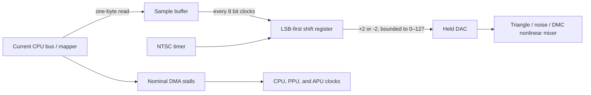

# DMC and APU IRQ integration

The DMC increment adds the fifth base NES audio channel, mapped sample reads,
nominal DMA stalls, and CPU delivery of both APU IRQ sources. It preserves
batched synthesis. The current CPU executes whole instructions, so this is a
functional NTSC implementation with explicit timing limits.

## Try the original sample

```bash
python scripts/apu_pilot.py --demo-channel dmc --output build/dmc.wav
python scripts/apu_pilot.py --output build/apu-pilot.wav
python nes.py rom/game.nes --audio-pilot
```

The generated demo creates and delta-encodes its own decaying drum waveform.
Its 257-byte sample lives at `$C800` in the generated NROM cartridge and is
retriggered for each of the demo's four notes. No commercial sample is bundled.
The normal demo mixes the sample with the other four channels.

## Register behavior

| Register | Behavior |
|---|---|
| `$4010` | IRQ enable, loop, and the 16 NTSC rate indices; clearing IRQ enable acknowledges the DMC IRQ |
| `$4011` | Directly loads the held 7-bit DAC; it contributes to mixing even with the reader disabled |
| `$4012` | Next sample start: `$C000 + value * 64` |
| `$4013` | Next sample length: `value * 16 + 1` bytes |
| `$4015` write, bit 4 | Stops the reader when clear; restarts an exhausted reader when set; every write acknowledges DMC IRQ |
| `$4015` read, bit 4 | Indicates unread sample bytes, independently of buffered bits still playing |
| `$4015` read, bit 6 | Frame IRQ; a status read acknowledges this source |
| `$4015` read, bit 7 | DMC IRQ; reading status does not acknowledge this source |

The frame and DMC IRQ flags are ORed into the CPU's level-sensitive input.
Clearing one source leaves the line asserted while the other remains pending.
CPU entry pushes the return PC and status with B clear, sets I, loads the IRQ
vector at `$FFFE`, and consumes seven cycles. Servicing an IRQ does not clear
its source. CLI, SEI, and PLP use the old I flag for their interrupt poll;
RTI restores the mask immediately. NMI remains the existing PPU interrupt path.

## Sample pipeline



The reader fills an empty one-byte buffer. Its address wraps from `$FFFF` to
`$8000`; each read uses the current mapper bank. Fetching the last byte either
restarts a loop or raises the enabled IRQ, before that buffered byte finishes
playing. The output timer continues while idle. Each active bit adds or
subtracts two without wrapping the DAC; a silent cycle holds its output.

Stopping the reader preserves already buffered audio and the current DAC.
Writing new address/length registers does not restart an active sample. These
details matter for repeated samples and the DMC's use as an IRQ timer.

## Keeping the CPU and audio synchronized

`APU.next_cpu_event` predicts the next frame IRQ or DMC memory fetch. The NES
checks this integer while publishing elapsed CPU time, and synthesizes only
when that event is reached or APU I/O/PCM consumption requires it. It does not
call synthesis on every CPU instruction or DMC bit.

The DMC reader requests a nominal three-cycle initial load or four-cycle
refill stall. The NES consumes those requests, adds their cycles to the CPU,
and advances the PPU and APU through the added time. Fetches caused by stalls
are also accounted for before returning from the CPU step. A later PCM drain
therefore cannot introduce unaccounted memory reads during normal NES execution.

Standalone users can pass `APU(dmc_reader=read_byte, irq_callback=set_irq)`.
They own the CPU timeline and must consume `take_dma_stall_cycles()` and feed
the elapsed stall time back into their host clocks. Without a reader, the
standalone APU supplies zero sample bytes.

The mixer includes the DMC DAC in its nonlinear TND lookup, including its
effect on triangle/noise gain. Fixed output gain reserves 20% headroom at the
maximum five-channel input; this lowers individual voices relative to the
earlier four-channel normalization.

## Accuracy limits and validation

DMA uses instruction boundaries and nominal stalls. It does not reproduce
the initial 3/4-cycle scheduling delay, retries on CPU writes, overlapping
OAM/DMC arbitration, aborted transfers, or DMA-induced repeated controller/PPU
register reads. IRQ delivery does not model all sub-instruction polling,
adjacent-cycle frame IRQ edges, or interrupt hijacking. APU reset uses the
emulator's deterministic power-on policy. PAL, band-limited resampling, and
audio-device clock feedback remain pending.

```bash
python -m pytest tests/test_cpu.py tests/test_dmc.py tests/test_apu_irq_dma.py tests/test_apu.py tests/test_apu_pilot.py tests/test_app.py
python -m ruff check .
```

Tests use generated samples and ROMs. They check bit order and DAC limits,
rates, buffered stop/restart, loop and address wrap, status acknowledgement,
combined IRQ sources, CPU entry/return, changing mapper banks, stall accounting,
batching, and PCM equivalence across chunk sizes. The real SDL dummy mixer
test exercises all five channels; audible output still needs listening checks.
See the [performance report](../performance/performance-report.md) for measured
overhead and the [pilot guide](pilot.md) for device setup.

To measure a local scene with music, choose a suitable warmup for that ROM:

```bash
python scripts/profile_performance.py --rom rom/game.nes --audio-pilot --warmup-frames 360 --frames 120
python scripts/profile_performance.py --rom rom/game.nes --audio-pilot --dmc-stress --warmup-frames 360 --frames 120
```

`--dmc-stress` forces continuous fastest-rate reads and keeps the DMC enabled
even if the game disables it. It changes the game's audio register writes for
this benchmark only; it measures an artificial load, not normal playback.

Hardware references: [DMC](https://www.nesdev.org/wiki/APU_DMC),
[DMA](https://www.nesdev.org/wiki/DMA),
[APU status](https://www.nesdev.org/wiki/APU_Status),
[CPU interrupts](https://www.nesdev.org/wiki/CPU_interrupts), and
[mixer](https://www.nesdev.org/wiki/APU_Mixer).
