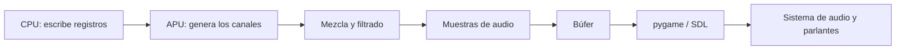

# Cómo funciona la APU de la NES

La **APU —Audio Processing Unit— es el circuito que genera el sonido de la
NES**. Funciona como un pequeño sintetizador: el programa del juego configura
sus parámetros y la APU produce las ondas mientras avanza el tiempo emulado.

Podemos pensar en la CPU como quien dirige una banda y en la APU como sus
instrumentos.

## Los cinco canales

La NES tiene cinco canales de sonido que pueden sonar simultáneamente:

| Canal | Qué produce | Uso habitual |
|---|---|---|
| Pulso 1 | Onda rectangular configurable | Melodía y efectos |
| Pulso 2 | Otra onda rectangular independiente | Armonía, acompañamiento y efectos |
| Triángulo | Onda triangular escalonada | Bajos |
| Ruido | Secuencias de ruido generadas electrónicamente | Percusión, explosiones y golpes |
| DMC | Reproducción de muestras codificadas en memoria | Percusión y sonidos grabados |

Esos usos son decisiones del compositor; el hardware permite combinarlos de
distintas maneras. El ruido se genera mediante un circuito determinista; los
canales de pulso y triángulo sintetizan ondas. El DMC lee muestras codificadas
en la memoria del juego.

Referencia: [APU basics](https://www.nesdev.org/wiki/APU_basics).

## Cómo aparece una nota

Para producir una nota en un canal de pulso, el juego configura varios elementos:

- **Período del temporizador:** determina la frecuencia, es decir, qué tan aguda
  o grave suena. Un período mayor produce un tono más grave.
- **Ancho del pulso:** cambia el timbre, aunque la nota sea la misma.
- **Volumen o envolvente:** permite mantener una intensidad o hacer que
  disminuya progresivamente.
- **Contador de duración:** puede detener automáticamente el canal.
- **Barrido de frecuencia:** permite que el tono suba o baje automáticamente.

Por ejemplo, un efecto de salto podría comenzar con un pulso breve cuyo tono
asciende mientras pierde volumen. La CPU configura y modifica esos parámetros;
la APU mantiene la oscilación entre las escrituras.

Referencia: [APU Pulse](https://www.nesdev.org/wiki/APU_Pulse).

## El reloj es fundamental

La APU se sincroniza con los ciclos de la CPU. Sus circuitos internos usan
distintos divisores. En una NES NTSC, la CPU funciona aproximadamente a
**1,79 millones de ciclos por segundo**.

Además, la APU tiene un secuenciador lento que actualiza envolventes, duraciones
y barridos. Este funciona independientemente del refresco de imagen de la PPU.
Por eso debemos avanzar el audio con el tiempo de la CPU, aunque entreguemos
las muestras al sistema en bloques.

Referencias: [Cycle reference chart](https://www.nesdev.org/wiki/Cycle_reference_chart)
y [APU](https://www.nesdev.org/wiki/NES_APU).

## Cómo llega el sonido a los parlantes

En el emulador, el recorrido es:

La mezcla original tiene un comportamiento **no lineal**: los canales
interactúan y el resultado requiere algo más elaborado que sumar sus volúmenes.
Reproducir esa mezcla ayuda a conservar el carácter del sonido de la consola.

Después hay que convertir la señal emulada en muestras digitales, por ejemplo
44.100 muestras por segundo. Cada muestra representa la amplitud del sonido en
un instante. Esas muestras se entregan en pequeños búferes: si no los llenamos
a tiempo aparecen cortes; si acumulamos demasiado audio aumenta el retraso
entre una acción y su sonido.

Referencia: [APU Mixer](https://www.nesdev.org/wiki/APU_Mixer).

## La parte más delicada: el DMC

El DMC lee muestras desde la memoria del juego. Esas lecturas pueden detener
brevemente la CPU y generar interrupciones IRQ. Su implementación afecta al
bus de memoria y a la sincronización general del emulador.

Referencia: [APU DMC](https://www.nesdev.org/wiki/DMC).

## Del concepto al piloto

Antes de este piloto, las escrituras destinadas al audio quedaban almacenadas
en un arreglo de bytes de `NESBus`, sin un circuito que generara sonido.

El primer incremento conectó el canal de pulso 1 al bus y al reloj de la CPU.
El piloto actual incorpora también pulso 2, triángulo, ruido y DMC, con sus
contadores y una mezcla conjunta. El DMC lee el cartucho, añade pausas a los
relojes emulados y puede generar IRQ, al igual que el secuenciador de cuadros.
Una demo con datos generados, con opción de escuchar cada canal por separado,
y la exportación WAV permiten comprobar el sonido
sin depender de una ROM privada ni de la configuración de audio de WSL.
La reproducción con pygame es otra capa y se activa explícitamente.

El alcance, los comandos de prueba y las limitaciones del piloto se describen
en [APU pilot](pilot.md) y [DMC e IRQ](dmc.md). La temporización precisa de DMA
e interrupciones, el filtrado y la sincronización con el dispositivo requieren
incrementos posteriores.
