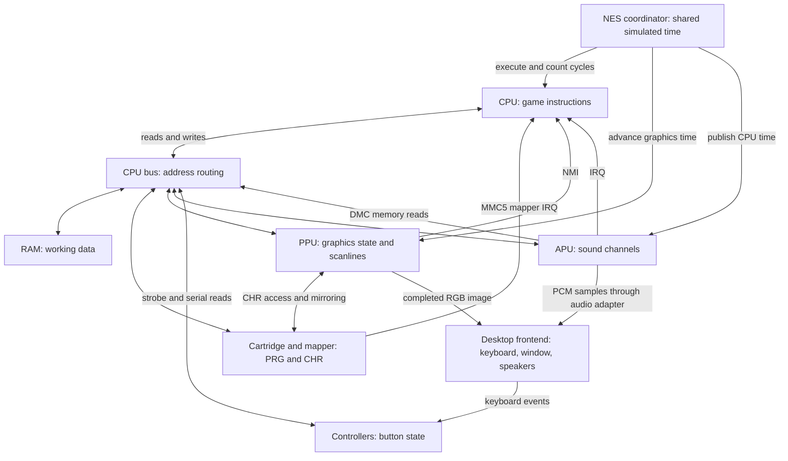

# How a NES emulator works

An emulator is a program that reproduces the behavior of another machine well
enough to run that machine's software. In pynes, Python code models the NES CPU,
memory, graphics, sound, controllers, and cartridge hardware. The game supplies
the instructions; the emulator supplies the machine those instructions expect.

This guide starts with the basic ideas and follows them into the current pynes
implementation. You do not need to know assembly language or electronics.
Hardware concepts and implementation shortcuts are described separately so
that a working feature does not imply complete NES accuracy.

## Contents

- [The game and the emulated machine](#the-game-and-the-emulated-machine)
- [The parts and their connections](#the-parts-and-their-connections)
- [Cartridge and mapper: supplying the program](#cartridge-and-mapper-supplying-the-program)
- [CPU: executing instructions](#cpu-executing-instructions)
- [Bus and memory: delivering reads and writes](#bus-and-memory-delivering-reads-and-writes)
- [PPU: turning tiles into an image](#ppu-turning-tiles-into-an-image)
- [APU: turning register changes into sound](#apu-turning-register-changes-into-sound)
- [Controllers: getting input into the game](#controllers-getting-input-into-the-game)
- [Timing: making the parts agree](#timing-making-the-parts-agree)
- [One button press from beginning to end](#one-button-press-from-beginning-to-end)
- [Performance and accuracy](#performance-and-accuracy)
- [Finding your way through the source](#finding-your-way-through-the-source)
- [Further reading](#further-reading)

## The game and the emulated machine

The game contains its own rules: movement, collisions, enemies, level changes,
and the sequence of notes in a song. Its program assumes it is running on a NES.
For example, it expects a read from a controller address to return button bits
and a write to a graphics register to affect the picture.

The emulator implements those expectations. It does not need a special Python
function for each enemy or level. If the same hardware behavior is reproduced
correctly, different games can use it without changes to the emulator.

There are two machines to keep in mind:

- The **guest** is the NES being modeled, with its own instructions and clocks.
- The **host** is the computer running Python, pygame, and the operating system.

The host executes Python instructions that interpret the guest's instructions.
A guest CPU cycle is therefore a unit of simulated time, not one instruction
of the host CPU. Running the same emulated frame can take different amounts of
real time on different computers.

## The parts and their connections

Think of the CPU as a worker following instructions and the bus as the routing
system that delivers its requests. Other devices keep their own state and
advance as simulated time passes.



The arrows represent communication, not Python threads. pynes advances the
hardware models through a coordinated execution loop. The audio device consumes
queued output separately through pygame and SDL.

## Cartridge and mapper: supplying the program

A ROM file is a dump of cartridge data. The supported iNES format starts with a
header describing its layout and mapper. The loader uses that information to
construct a cartridge with:

- **PRG ROM:** program instructions and data used by the CPU, such as level
  layouts and music commands.
- **CHR ROM or CHR RAM:** tile patterns used by the PPU. With CHR RAM, the game
  can upload and change those patterns while it runs.
- **A mapper:** a model of the cartridge circuitry that selects which data is
  visible at particular CPU and PPU addresses.

The CPU can address only 64 KiB at once, and some of that address space belongs
to RAM and devices. Larger games use **bank switching**: a mapper changes which
portion of the cartridge appears in a particular address window. Imagine a
small desk on which different pages of a much larger book can be placed.

A **bit** holds 0 or 1, a **byte** holds eight bits, and a **KiB** is 1,024
bytes. A CPU address identifies where a byte can be read or written; a value
stored at that address is the data itself.

For example, writing to a mapper register can make a later CPU read from the
same address return a byte from a different PRG bank. CHR bank selection and
nametable mirroring can similarly change what the PPU sees. Correct rendering
therefore depends on the cartridge model as well as the graphics code.

pynes implements basic NROM (mapper 0), MMC1 (mapper 1), UxROM (mapper 2), and
experimental MMC5 (mapper 5) support through
[cartridge.py](../src/nes_py/cartridge.py). Supporting these mapper
numbers does not cover every board variation or cartridge feature. The loader
also reads a basic subset of NES 2.0, which extends the header with explicit
hardware information. See [cartridge formats](cartridge-formats.md) for the
supported combinations. Battery-backed save persistence is not implemented.

MMC5 illustrates how much a cartridge can add to the machine: it supplies
banked RAM, per-tile background attributes, different CHR banks for rendering
contexts, a multiplier, and a scanline interrupt. Its current implementation
is explained in the [MMC5 guide](mappers/mmc5.md).

## CPU: executing instructions

The NES uses a processor based on the 6502. The emulator keeps its working state
in a `CPU6502` object:

| State | Meaning |
|---|---|
| Program counter, `PC` | Address of the next instruction byte |
| Accumulator, `A` | Small working value used by many instructions |
| Index registers, `X` and `Y` | Values often used to index tables or count loops |
| Stack pointer, `SP` | Position in the CPU's stack, used for calls and interrupts |
| Status flags | Results such as zero, negative, carry, and interrupt masking |
| Cycle count | How much guest CPU time has elapsed |

Executing an instruction has four conceptual steps:

1. **Fetch:** read the next opcode byte through the bus and advance `PC`.
2. **Decode:** determine the operation and how its operands are addressed.
3. **Execute:** update registers, flags, or memory through the bus.
4. **Account for time:** add the instruction's CPU cycles, including applicable
   branch or page-crossing costs.

Here is a small example. The `$` prefix means hexadecimal, and `#` means a
literal value rather than a memory address.

```asm
LDA #$03     ; Put the value 3 in A.                       2 CPU cycles
STA $00      ; Write A to RAM address $0000.              3 CPU cycles
LDA $0800    ; Read a mirror of that same RAM location.   4 CPU cycles
```

In ROM, these instructions are the bytes `A9 03 85 00 AD 00 08`. For example,
`A9` tells the CPU to load a literal into `A`, and the following byte, `03`,
is that literal. Assembly names such as `LDA` make those bytes easier to read.

After these instructions, `A` is still 3. They consume 9 CPU cycles, so the
NES coordinator advances the PPU by 27 cycles. This assumes no additional
interrupt or DMA activity. Mirroring, explained next, makes `$0000` and `$0800`
refer to the same byte.

On reset, the CPU reads two bytes at `$FFFC` and `$FFFD` to find the starting
program address. This is the **reset vector**. Those reads also go through the
bus and the cartridge's current mapping.

In [cpu.py](../src/nes_py/cpu.py), `CPU6502.step()` executes one instruction or
services an IRQ. It does not execute just one CPU cycle. The core supports the
official opcodes; unsupported opcodes raise `CPUError`.

## Bus and memory: delivering reads and writes

An address is not necessarily a location in ordinary RAM. The **memory bus**
decides which device handles a read or write. A device register is an address
through which software observes or changes hardware state.

This is the main routing implemented by `NESBus` in
[nes.py](../src/nes_py/nes.py):

| CPU address | Destination in pynes |
|---|---|
| `$0000`–`$1FFF` | 2 KiB of internal RAM, repeated through mirroring |
| `$2000`–`$3FFF` | Eight PPU registers, repeated every eight addresses |
| `$4000`–`$4013` | APU channel registers when the pilot is enabled |
| `$4014` | Write: transfer a 256-byte page into sprite OAM |
| `$4015` | APU enable control on writes; channel and interrupt status on reads |
| `$4016` | Controller strobe on writes; controller 1 serial input on reads |
| `$4017` | APU frame-sequencer control on writes; controller 2 input on reads |
| `$4020`–`$7FFF` | Expansion/cartridge RAM area; behavior depends on the format and declared RAM |
| `$8000`–`$FFFF` | Cartridge PRG ROM/RAM windows and mapper writes |

The [NESdev CPU memory map](https://www.nesdev.org/wiki/CPU_memory_map)
describes the hardware address regions; the table above describes this
implementation's routing and its limitations.

For supported NROM/MMC1 NES 2.0 boards, 8 KiB of PRG RAM is mapped at `$6000`–`$7FFF`
only when declared. Absent RAM and unused expansion addresses return the last
bus value. Legacy iNES keeps its earlier placeholder expansion storage.
MMC5 has its own registers and extended RAM within `$5000`–`$5FFF`, plus
banked PRG RAM that can also occupy parts of `$8000`–`$DFFF`.

**Mirroring** means multiple addresses select the same underlying storage. The
2 KiB RAM occupies `$0000`–`$07FF`; `$0800`–`$0FFF` repeats it, as do two more
regions. pynes uses one RAM array and maps these addresses to the same indexes.

Device reads and writes can have side effects. For example, reading controller
input advances its serial position, and reading PPU status clears the vblank
flag and resets the shared scroll/address write latch. Consequently, replacing
the bus with a plain 64 KiB array would lose essential behavior. Debugging reads
must also be chosen carefully when inspecting device registers.

The CPU and PPU have **different address spaces**. CPU address `$2000` selects
a PPU control register. PPU address `$2000` selects nametable data. Games access
PPU memory through the CPU-visible PPU address and data registers; these two
uses of `$2000` are not the same memory location.

## PPU: turning tiles into an image

The **Picture Processing Unit**, or PPU, builds a 256 by 240 pixel image from
compact graphics data. The CPU configures it through registers; it does not
normally send a complete RGB picture every frame.

### Backgrounds, patterns, and palettes

A background is assembled from 8 by 8 pixel **tiles**:

1. A **nametable** says which tile appears at each background position.
2. A **pattern table** supplies the tile's pixels from cartridge CHR memory.
3. **Attribute data** selects a background palette for a group of tiles.
4. **Palette RAM** supplies color codes, which pynes converts to RGB values.

A tile pixel contains two bits, giving a value from 0 to 3. That value selects
an entry in a palette; it is not itself an RGB color. For example, pixel value
2 can appear blue in one palette and red in another. A palette write can
therefore recolor existing patterns without replacing the tile graphics.

pynes uses a fixed RGB lookup table to represent the NES color codes. Incorrect
colors can come from pattern decoding, attribute selection, palette addressing,
or the RGB conversion. The original console's video signal and display also
affect its appearance; the current renderer does not simulate that full analog
path or color-emphasis behavior.

### Sprites and scrolling

**Sprites** are separately positioned graphics used for characters, enemies,
and other objects. Their coordinates, tile numbers, palettes, flipping, and
priority are stored in **Object Attribute Memory**, or OAM.

The model has 64 sprite entries. Its renderer considers up to eight sprites per
scanline and combines their nontransparent pixels with the background according
to priority. The sprite-zero-hit flag reports certain overlaps between sprite
0 and the background; games can use that event to time screen changes.

Scrolling changes which part of the background is visible. A game can change
scroll settings during a frame, for example to keep a status bar stationary
while the playfield moves. Getting this right requires tracking address latches,
fine scrolling, nametable mirroring, and the moment each change takes effect.

This explains why a scene can have the right tiles yet show displaced rows or
an incorrect split. Drawing the right data at the wrong simulated time can
still produce the wrong image.

### From scanlines to a desktop window

A **scanline** is one horizontal line of the video frame. In pynes,
[ppu.py](../src/nes_py/ppu.py) advances between selected rendering events and
composes a visible scanline as a batch. At vblank it converts the completed
indexed image into a reusable RGB buffer.

A **framebuffer** is memory holding the image's pixels. The RGB buffer here
contains three bytes per pixel, or `256 × 240 × 3 = 184,320` bytes. Reusing it
avoids allocating and converting a new list of color tuples for every display
update.

**Vertical blank**, or vblank, is the interval after the visible picture during
which games commonly prepare graphics updates. If enabled, the PPU signals an
NMI to the CPU when vblank begins. The game decides what work its interrupt
handler performs.

The desktop frontend shares the RGB buffer with pygame, scales it to fit the
window while preserving its aspect ratio, and presents it with black borders
where needed. Maximizing the window changes the host presentation size; the
emulated picture remains 256 by 240.

The current PPU approximates sprite-zero-hit and overflow behavior and does not
reproduce all effects that depend on changes within a scanline.

## APU: turning register changes into sound

The **Audio Processing Unit**, or APU, is a programmable sound generator.
The game runs music and sound-effect code on the CPU, which writes channel
registers to control pitch, duration, and output level.

The [NES APU reference](https://www.nesdev.org/wiki/NES_APU) describes five base
channels, all represented in the current pilot:

| Channel | Basic sound mechanism |
|---|---|
| Pulse 1 | A repeating pulse with selectable duty cycle and pitch controls |
| Pulse 2 | A second independent pulse voice |
| Triangle | A stepped triangle waveform, often used for bass |
| Noise | A shift-register sequence, useful for percussion and noisy effects |
| DMC | Encoded sample bits that raise or lower an output level |

For example, the CPU can configure a pulse channel and continue executing game
logic. The APU keeps advancing its waveform as simulated time passes. Further
register writes change the note or envelope. The game program determines the
melody; the APU generates the resulting waveform.

The **DMC** also reads sample bytes through the CPU bus. Those reads depend on
the current cartridge mapping and briefly stall CPU execution. Sound therefore
affects memory access and timing, as well as the final audio output.

To play the sound on a computer, pynes samples the modeled channel outputs at
44,100 samples per second by default, mixes them using nonlinear pulse and
triangle/noise/DMC relationships, and produces mono 16-bit **PCM**. PCM is a
sequence of numeric signal levels that an audio device can play. It can also
be written to a WAV file without an audio device.

The audio sample clock is different from the approximately 1.79 MHz guest CPU
clock. The APU tracks the elapsed CPU timeline and generates samples at their
scheduled points. Sampling and channel updates are batched to reduce Python
overhead. Before a register change takes effect, deferred synthesis catches up
using the old settings, preserving the order of events within the model's
timing resolution.

[apu.py](../src/nes_py/apu.py) implements synthesis and interrupts;
[audio.py](../src/nes_py/audio.py) handles WAV output and pygame playback.
The playback adapter keeps its pending queue bounded, discarding older pending
samples if necessary. This limits accumulated backlog, but underruns, host
device latency, and clock drift still need attention. The pilot does not yet
provide band-limited synthesis or a complete analog output model.

Audio is opt-in with `--audio-pilot`; the default NES core has no APU instance.
See the [APU pilot guide](apu/pilot.md), [DMC guide](apu/dmc.md), and original
[APU explanation in Spanish](apu/overview.es.md) for more detail.

## Controllers: getting input into the game

A keyboard event is translated into controller button state. In the current
desktop bindings, **Z is NES A** and **X is NES B**.

The game obtains that state through the controller interface:

1. It writes a strobe sequence to `$4016` to capture the buttons.
2. It reads `$4016` repeatedly for controller 1, receiving one button bit per
   read: A, B, Select, Start, Up, Down, Left, Right.
3. Its own CPU instructions decide what the captured buttons mean.

Pressing Z therefore sets a button bit. The game's program may interpret it as
jump, confirm, or another action. Movement and collision rules remain in the
game. [input.py](../src/nes_py/input.py) models the strobe and serial reads;
[app.py](../src/nes_py/app.py) translates keyboard events.

## Timing: making the parts agree

Hardware devices run together. A practical emulator can advance their models
in turns, provided that their interactions preserve the necessary ordering.

pynes uses these NTSC-oriented timing values:

| Quantity | Current model |
|---|---|
| Guest CPU clock used by the APU | 1,789,773 cycles per second |
| PPU clock relationship | 3 PPU cycles per CPU cycle |
| PPU frame layout | 262 scanlines of 341 PPU cycles each |
| Desktop pacing target | 60 frames per second |
| Default audio sample rate | 44,100 samples per second |

The [cycle reference chart](https://www.nesdev.org/wiki/Cycle_reference_chart)
documents hardware timing differences between systems. pynes uses a fixed
frame length and omits the NTSC odd-frame skipped dot, so its simulated frame
rate is approximately 60.1 Hz rather than an exact match to hardware. The host
60 Hz limiter is another approximation. PAL timing is not implemented.

### What one system step does

`NES.step()` coordinates the devices:

1. Execute one CPU instruction or IRQ entry.
2. Add pending OAM DMA stall time. OAM DMA copies a 256-byte CPU memory page
   into sprite memory and costs 513 or 514 CPU cycles in this model.
3. Advance the PPU by three times the elapsed CPU cycles. An NMI can add CPU
   interrupt-service cycles during this work.
4. Publish the updated CPU time to the APU, if enabled. Flush deferred APU work
   when a predicted CPU-visible event is due, such as a DMC fetch or frame IRQ.
5. Feed any additional NMI or DMC stall cycles back through the clocks until
   all elapsed time is accounted for.

DMA means **Direct Memory Access**: a device transfers data while the CPU gives
up execution time. The rest of the modeled hardware keeps advancing during the
stall. pynes accounts for nominal OAM/DMC stalls; exact bus-cycle arbitration
and some related hardware quirks remain incomplete.

An **interrupt** redirects the CPU to a handler in the game program. NMI is the
PPU's non-maskable notification, commonly used for vblank. IRQ is a maskable
request; the APU's frame sequencer, DMC, and MMC5 scanline counter can assert it.
The CPU receives the combined level, so acknowledging one device leaves another
device's pending request active. The core preserves the
CPU's return state on the stack and loads the relevant interrupt vector.
Acknowledging an APU interrupt source is distinct from merely entering its CPU
handler.

### What one displayed frame does

`NES.run_frame()` repeats system steps until the PPU frame counter changes.
The desktop frontend then obtains audio, presents the RGB buffer, and waits as
needed for its pacing target. The following diagram summarizes the normal
flow; device accesses also occur during the instruction itself.

```mermaid
sequenceDiagram
    participant App as Desktop frontend
    participant NES as NES coordinator
    participant CPU as CPU
    participant Bus as CPU bus
    participant PPU as PPU
    participant APU as Optional APU

    App->>NES: run_frame()
    loop Until the PPU frame counter changes
        NES->>CPU: step()
        CPU->>Bus: Fetch instruction and access devices
        Bus-->>CPU: Read results and write side effects
        CPU-->>NES: Updated CPU cycle count
        Note over NES: Include pending OAM DMA stalls
        NES->>PPU: Advance 3 PPU cycles per elapsed CPU cycle
        opt Vblank begins with NMI enabled
            PPU->>CPU: NMI entry adds CPU cycles
        end
        opt Audio enabled
            NES->>APU: Publish CPU time; flush when required
            APU->>Bus: Read DMC memory when a fetch is due
            APU-->>NES: Report nominal DMC stall cycles
        end
        Note over NES: Advance clocks for additional interrupt and DMA time
    end
    NES-->>App: Frame complete
    opt Audio enabled
        App->>APU: Drain PCM samples, flushing deferred synthesis
        APU-->>App: PCM bytes
    end
    Note over App: Queue audio, scale and present RGB, apply pacing
```

This is instruction-level CPU execution with scanline-based graphics and
batched audio. It is not a model of every electrical transition or every bus
access on its exact hardware cycle. That distinction matters for games that
depend on precise mid-scanline changes or DMA interactions.

## One button press from beginning to end

Suppose a game uses NES A to jump and play a sound:

1. pygame receives a Z key-down event. The frontend sets controller 1's A bit.
2. The game polls `$4016` through CPU instructions and sees A pressed.
3. The game updates its own player position and velocity in RAM. Its collision
   code decides whether the jump is allowed.
4. It prepares new sprite entries, often in a RAM page, and starts an OAM DMA
   transfer through `$4014` at the appropriate point in its frame logic.
5. It writes APU registers to start the sound effect, if the APU is enabled.
6. While CPU time advances, the PPU combines the updated sprites and background,
   and the APU generates the corresponding samples.
7. The frontend presents the completed image and queues the samples for output.

The exact polling and update order depends on the game. The causal chain is
shared: host input becomes hardware state, guest instructions react to it,
hardware models generate output, and host devices present that output.

## Performance and accuracy

At a 60 Hz presentation target, the host has roughly **16.7 ms** for each frame.
CPU interpretation, PPU rendering, audio synthesis, scaling, and output all
consume that budget. If total work repeatedly exceeds it, the current loop
produces fewer frames per real second. The game and controls can then feel
slower even though the guest devices retain their relative clock ratios.

Different symptoms suggest different investigations:

| Symptom | Useful next measurement |
|---|---|
| Low FPS and slower game response | CPU/PPU/APU work time and missed frame deadlines |
| More slowdown in a large window | Scaling and presentation time |
| Wrong tiles or displaced rows at steady FPS | Mapper state, scrolling, register timing, and sprite composition |
| Wrong colors at steady FPS | Pattern bits, attribute selection, palette addressing, and RGB conversion |
| Delayed or broken sound | Synthesis time, queued audio, device behavior, and clock synchronization |

A scene such as a water level can expose heavier CPU work, different scrolling,
or timing-sensitive effects. The scene alone does not establish whether the
cause is performance or emulation accuracy; the two problems can coexist.

Press **F3** to view average FPS and `emu`, `audio`, `video`, and `slow` values
in the title. `emu` includes CPU/PPU work and scheduled APU events; `audio`
includes deferred synthesis and queuing. `slow X/N` counts frames exceeding
the work budget, excluding the pacing wait. These are host measurements.

For a repeatable comparison without a window, use a locally supplied ROM:

```bash
python scripts/profile_performance.py --rom rom/game.nes --audio-pilot --frames 120 --warmup-frames 300
```

Choose a warmup that reaches the scene being investigated. Headless throughput
does not include desktop scaling or audio-device playback. Keep proprietary
ROMs and generated captures local; the tests use generated programs and data.
See the [performance report](performance/performance-report.md) for methods
and existing measurements.

Safe optimizations avoid repeated work while preserving observable results:
reuse image buffers, cache tile decoding with the correct data and mapper
state, and advance sound in batches between events. Comparing CPU state,
rendered pixels, and PCM samples helps detect an optimization that changes
behavior.

Passing tests establishes the scenarios covered by those tests. A complete
compatibility claim also needs broader hardware tests and game validation.
Current gaps include unofficial CPU opcodes, additional mappers, exact PPU
effects and interrupt/DMA timing, PAL support, and further audio refinement.
Consult [Current Limitations](../README.md#current-limitations) for the
maintained feature boundary.

## Finding your way through the source

Start with the coordinator, then follow the device that interests you:

| File | What to read for |
|---|---|
| [src/nes_py/nes.py](../src/nes_py/nes.py) | Device construction, `NESBus`, `NES.step()`, and `NES.run_frame()` |
| [src/nes_py/cpu.py](../src/nes_py/cpu.py) | Registers, opcode dispatch, addressing, flags, interrupts, and cycle costs |
| [src/nes_py/cartridge.py](../src/nes_py/cartridge.py) | iNES loading, PRG/CHR storage, bank switching, and mirroring |
| [src/nes_py/mmc5.py](../src/nes_py/mmc5.py) | MMC5 RAM/ROM windows, graphics contexts, extended RAM, and mapper IRQs |
| [src/nes_py/ppu.py](../src/nes_py/ppu.py) | PPU registers, scroll state, scanlines, sprites, palettes, and RGB output |
| [src/nes_py/apu.py](../src/nes_py/apu.py) | Channel state, event scheduling, DMC, mixing, and PCM generation |
| [src/nes_py/input.py](../src/nes_py/input.py) | Button latching and serial controller reads |
| [src/nes_py/app.py](../src/nes_py/app.py) | Keyboard events, desktop loop, resizing, frame timings, and pacing |
| [src/nes_py/audio.py](../src/nes_py/audio.py) | Bounded playback queues and WAV export |
| [src/nes_py/debug.py](../src/nes_py/debug.py) | Headless execution, traces, and inspection helpers |
| [src/nes_py/cli.py](../src/nes_py/cli.py) | CLI options and selection of desktop or headless execution |
| [tests/](../tests/) | Generated examples of expected behavior and regression coverage |

The root [nes.py](../nes.py) is the convenient launcher; the hardware
coordination code lives in [src/nes_py/nes.py](../src/nes_py/nes.py). Both lead
into the same package. The desktop and headless runners use the same core, so
hardware behavior can be investigated without a window or audio device.

## Further reading

For hardware details beyond this introduction:

- [NESdev: CPU memory map](https://www.nesdev.org/wiki/CPU_memory_map)
- [NESdev: PPU rendering](https://www.nesdev.org/wiki/PPU_rendering)
- [NESdev: PPU scrolling](https://www.nesdev.org/wiki/PPU_scrolling)
- [NESdev: cycle reference chart](https://www.nesdev.org/wiki/Cycle_reference_chart)
- [NESdev: NES APU](https://www.nesdev.org/wiki/NES_APU)
- [NESdev: DMA](https://www.nesdev.org/wiki/DMA)
- [NESdev: CPU interrupts](https://www.nesdev.org/wiki/CPU_interrupts)

For this project's usage, scope, and deeper audio documentation:

- [README](../README.md)
- [APU pilot implementation](apu/pilot.md)
- [DMC playback and interrupts](apu/dmc.md)
- [APU introduction in Spanish](apu/overview.es.md)
- [Performance measurements](performance/performance-report.md)
